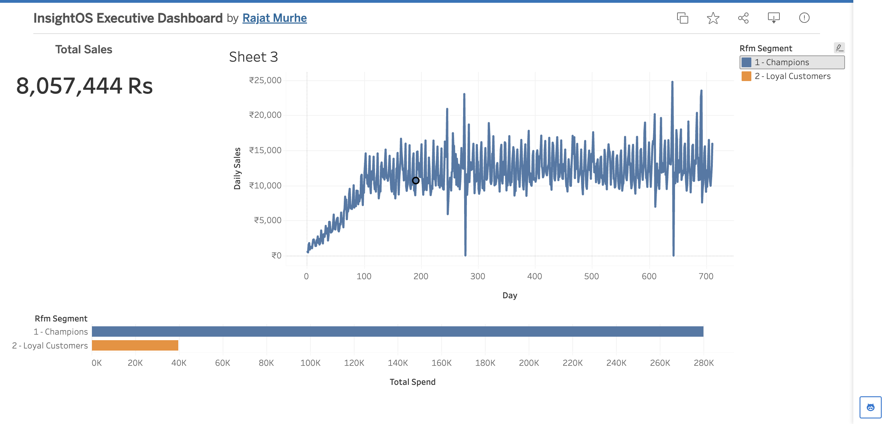

# InsightOS: Retail Analytics and Anomaly Detection Pipeline

A batch pipeline that loads two years of grocery transactions into PostgreSQL, checks data quality, computes executive KPIs and RFM customer segments in SQL, flags unusual sales days with an Isolation Forest, and turns them into an executive alert. The results feed a Tableau dashboard.

[](https://public.tableau.com/app/profile/rajat.murhe/viz/InsightOSExecutiveDashboard/Dashboard1)

**[Open the interactive Tableau Public dashboard](https://public.tableau.com/app/profile/rajat.murhe/viz/InsightOSExecutiveDashboard/Dashboard1)**

## Data

[dunnhumby, *The Complete Journey*](https://www.dunnhumby.com/source-files/): household level transactions over 711 days from 2,500 households. The raw CSVs are not committed; download them and place `transaction_data.csv` and `product.csv` in `data/raw/`.

## Pipeline

| Step | Code | What it does |
| --- | --- | --- |
| Load | `src/pipeline/load_raw.py`, `sql/schema.sql` | Creates the `products` and `transactions` tables (keys and indexes), then truncates and reloads them, so reruns give the same result |
| Data quality | `src/pipeline/quality_checks.py` | Blocking checks: null keys, duplicate product ids, transactions with no product. Warnings: negative sales, quantity over 100, missing days. Writes `dq_report.csv` |
| KPIs | `sql/kpis.sql` | Total sales, baskets, households, average basket value, built from CTEs. Unit KPIs leave out fuel and misc departments (see below) |
| Segments | `sql/rfm.sql` | RFM scoring in SQL with `NTILE(5)` window functions and five segments (Champions, Loyal, New or Promising, At Risk, Hibernating) |
| Anomalies | `src/anomaly/sales_anomaly.py` | Isolation Forest (3% contamination) on daily sales and the ratio to the trailing 7 day median, after a 100 day warm up |
| Alert | `src/anomaly/llm_alert.py` | Builds an executive prompt from the anomalies; with `OPENAI_API_KEY` set it calls an OpenAI compatible API and saves the email to `reports/` |

Run everything with `python run_pipeline.py`.

## Findings and fixes

- **Unit KPIs.** An earlier export reported 944.89 units per basket. In this dataset the `QUANTITY` of fuel (KIOSK-GAS) and misc transactions is not an item count, so they inflated it. `kpis.sql` now excludes those departments from unit KPIs, and the quality checks report rows with quantity over 100 by department. Until the next full run, `kpis_executive.csv` holds only the value based KPIs.
- **Anomalies.** The panel ramps up over the first ~100 days (median daily sales climb from about 1.8k to 10k), which a plain model flags as anomalies. With the warm up and the trailing median ratio, the 19 flagged days are now real breaks: two near zero days (278 and 643, likely tracking failures), spikes up to 1.8 times the trailing median, and the dips that follow some spikes. See `data/dashboard/anomalies.csv` and `reports/llm_executive_prompt.txt`.

## Run it

```bash
pip install -r requirements.txt
export INSIGHTOS_DB_URI="postgresql+psycopg://<user>:<password>@localhost:5432/insightos"
python run_pipeline.py
pytest -q        # end to end test on a small synthetic sample (SQLite by default)
```

Set `TEST_DB_URI` to run the same test on PostgreSQL. GitHub Actions runs it on both SQLite and PostgreSQL 16 for every push. Credentials only come from environment variables (see `.env.example`).

## Repository layout

```text
run_pipeline.py            runs all steps in order
sql/                       schema, KPI, RFM and daily sales SQL
src/config.py              settings from environment variables
src/pipeline/              load, data quality checks, dashboard exports
src/anomaly/               Isolation Forest and the executive alert
data/dashboard/            CSVs behind the Tableau dashboard
reports/                   generated prompt (and alert, when an API key is set)
tests/                     end to end pytest
```

## Tech stack

Python (Pandas, SQLAlchemy, scikit learn), PostgreSQL, SQL (CTEs, window functions), Tableau, pytest, GitHub Actions.
